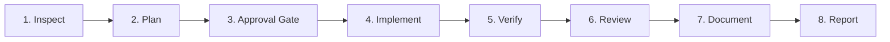

# ReRider Rentals — Master Project & Agent Directives (`AGENTS.md`)

> **Product**: ReRider Rentals  
> **Initial Hub**: Kochi (Ernakulam), Kerala, India  
> **Architecture**: Next.js 15 App Router • React 19 • TypeScript (Strict Mode) • PostgreSQL • Drizzle ORM • Tailwind CSS  
> **Status**: Production Operations System — Admin Fleet Management Completed  

---

## 1. Project Purpose & Business Model

**ReRider Rentals** is a commercial and private two-wheeler (bike and scooter) rental management platform engineered initially for an owner-operated business in Kochi, Kerala, India, and architected to scale into a multi-vehicle, multi-hub fleet operations platform.

### Core Business Context
- **Initial Fleet Target**: One second-hand petrol scooter (Honda Dio 110cc, registration `KL-00-AA-0000`).
- **Initial Capital Target**: ₹80,000 total investment (allocated as ₹70,000 vehicle acquisition cost + ₹10,000 initial expenses and working capital).
- **Target Customers**: Individual riders aged 20+ with valid Indian Driving Licences.
- **Primary Use Cases**: Commercial gig delivery/commute (Swiggy, Zomato, Uber, Rapido) and personal commute.
- **Rental Packages**: Duration-based packages (14-day standard and 26-day monthly packages).
- **Core Operational Philosophy**: This is not a simple CRUD application. It is a mission-critical operations platform with strict financial segregation, assignment auditability, regulatory safety gates, and maintenance locks.

---

## 2. Technology Stack & Architecture

- **Framework**: Next.js 15.5+ (App Router), React 19, TypeScript (Strict Mode).
- **Database & ORM**: PostgreSQL 16+, Drizzle ORM (`drizzle-orm`, `drizzle-kit`). Dual-resilient data layer with graceful in-memory fallback for offline test environments.
- **Styling**: Tailwind CSS with custom Swiggy-inspired design tokens.
- **Icons**: Lucide React.
- **Component Primitives**: shadcn/ui adapted to custom design tokens.
- **Forms & Validation**: Zod schemas (client and server actions), React Hook Form, React 19 `useActionState`.
- **Authentication**: Stateless, Edge-compatible signed JWT session cookies (`jose`), `bcryptjs` password hashing, Role-Based Access Control (RBAC).
- **Testing**: Vitest with v8 coverage.

---

## 3. Project Folder Conventions

```
rerider-rentals/
├── drizzle/                         # Drizzle ORM SQL migrations and metadata
│   └── migrations/                  # Generated migration files (*.sql)
├── public/                          # Static assets and icons
├── src/
│   ├── app/                         # Next.js 15 App Router routes and pages
│   │   ├── admin/                   # Admin Operations Portal
│   │   │   ├── vehicles/            # Fleet listing, onboarding, 360° command center, edit
│   │   │   ├── bookings/            # Booking management (Phase 4)
│   │   │   ├── assignments/         # Physical scooter handover & replacement (Phase 5)
│   │   │   └── riders/              # Rider verification & KYC queue (Phase 3)
│   │   ├── rider/                   # Rider Self-Service Portal
│   │   └── login/                   # Central authentication route
│   ├── components/
│   │   └── ui/                      # Base UI primitives (button, badge, card, input, label)
│   ├── features/                    # Feature-specific modules (actions, components, hooks)
│   │   └── vehicles/                # Actions and components for vehicle management
│   ├── lib/
│   │   ├── auth/                    # JWT session, passwords, RBAC definitions, cookie guards
│   │   ├── db/                      # Connection pool, health check, seed scripts
│   │   │   └── schema/              # Normalized Drizzle schemas (9 domain modules)
│   │   ├── validations/             # Zod validation schemas
│   │   └── utils.ts                 # Utility helpers (cn, currency, date formatting)
│   ├── services/                    # Pure domain service layer & business logic
│   └── tests/                       # Automated test suites (*.test.ts)
├── AGENTS.md                        # Project instructions and invariants (this document)
├── package.json                     # Scripts and dependencies
└── qa-results.json                  # Machine-readable test execution audit log
```

---

## 4. Coding Standards & Conventions

Where no existing convention conflicts, adhere strictly to:
- **TypeScript**: Strict mode enabled (`noImplicitAny`, strict null checks). Never use `any`; use typed generics, `unknown`, or domain models.
- **React Components**: Functional components with clean hooks (`useActionState`, `useState`, `useMemo`). Keep UI presentation separated from domain arithmetic.
- **Code Formatting**:
  - Two-space indentation.
  - Single quotes (`'`).
  - No semicolons (`semi: false`).
  - Strict equality operators (`===` and `!==`).
- **Domain Logic Placement**: All financial arithmetic, state transition validation, age gating, and document expiry logic MUST reside in `src/services/`, never in React components.
- **Validation**: All mutations (Server Actions) MUST validate inputs using Zod schemas from `src/lib/validations/`.
- **Design System Tokens (Swiggy-Inspired)**:
  - **Brand Orange**: `#fc8019`
  - **Charcoal (Headings & Primary Text)**: `#282c3f`
  - **Muted Slate (Body & Secondary Text)**: `#686b78`
  - **Borders & Dividers**: `#e9e9eb`
  - **Card Background**: `#ffffff` (8px border radius)
  - **Global Background**: `#f4f4f5`
  - **Pills & Status Badges**: `rounded-full`, light grey `#f1f1f6` or semantic status colors.
  - **WCAG AA Contrast Mandate**: White text on Brand Orange fails WCAG AA (2.56:1). All Primary Orange buttons and active interactive elements MUST use **Charcoal text (`#282c3f`)**, providing **5.41:1 contrast ratio**.
  - **Mobile Ergonomics**: Tested at 360px, 390px, 768px, and 1440px viewports with zero horizontal overflow (`overflow-x: hidden`). Minimum 44x44px touch targets.

---

## 5. Database & Migration Rules

- **Schema Inspection First**: Always inspect `src/lib/db/schema/` before modifying schema. Reuse existing tables; never create duplicate tables.
- **Table Modules**:
  1. `users`: System users and credentials.
  2. `riders`: Rider profiles, emergency contacts, driving license data.
  3. `vehicles`: Physical fleet assets, documents, status history, photos.
  4. `pricing`: Rental packages and vehicle-specific pricing matrix.
  5. `bookings`: Contract terms and frozen price snapshots.
  6. `assignments`: Physical scooter assignments and replacement lineage.
  7. `inspections`: Handover, return, and maintenance inspections.
  8. `financials`: Payments, security deposit liabilities, expenses.
  9. `maintenance`: Workshop records, repairs, accident incidents.
- **Migration Commands**:
  - Generate: `pnpm run db:generate`
  - Migrate: `pnpm run db:migrate`
  - Seed: `pnpm run db:seed`
- **Transactions**: Multi-table state mutations (e.g. vehicle replacement, status change with history, deposit collection) MUST execute within a database transaction (`db.transaction`).
- **Safety**: Never execute destructive database migrations (`DROP TABLE`, `DROP COLUMN`) without explicit user authorization.

---

## 6. Authentication & Authorisation Rules

- **Roles**:
  - `SUPER_ADMIN`: Full business, operational, and financial control.
  - `ADMIN`: Operations manager (fleet, pricing, bookings, rider verification).
  - `STAFF`: Field staff (inspections, handover, return, maintenance logs).
  - `RIDER`: Customer portal access for verified riders.
- **Server Guards** (`src/lib/auth/session.ts`):
  - `requireAuth()`: Ensures active session.
  - `requireAdmin()`: Enforces admin/staff authorization on operational routes and actions.
  - `requireRider()`: Enforces rider identity verification.
- **Session Tokens**: Cryptographically signed using `jose` with `HS256`, stored in HTTP-only, secure, same-site `lax` cookies.

---

## 7. Fundamental Business Invariants

The application must enforce these rules without exception:

1. **One Approved Rider per Booking**: A verified rider cannot rent on behalf of another person. Sub-renting, unauthorized rider transfers, and secondary drivers are strictly prohibited.
2. **Assignment Exclusivity**:
   - A vehicle can have at most ONE `ACTIVE` assignment at any instant.
   - A rider can have at most ONE `ACTIVE` rental assignment at any instant.
   - Enforced by PostgreSQL partial unique indexes (`uq_active_vehicle_assignment`, `uq_active_rider_assignment`).
3. **Booking vs. Assignment Decoupling**: A `booking` represents customer contractual terms and frozen pricing; a `vehicle_assignment` represents physical vehicle allocation. Replacing a breakdown scooter retains the original booking and leaves financial terms intact.
4. **Price Snapshot Immutability**: Confirmed bookings freeze rental rates, deposits, and token terms in `booking_price_snapshots`. Subsequent vehicle rate changes never alter past or active bookings.
5. **Vehicle-Specific Pricing Independence**: Vehicle A's pricing matrix never mutates Vehicle B's rates or global package definitions.
6. **Regulatory Compliance Gate**: Newly onboarded vehicles default to `PENDING_REVIEW` and **`UNAVAILABLE`** operational status. Vehicles CANNOT be marked `AVAILABLE` until Kerala MVD commercial compliance is verified by an admin.
7. **Maintenance & Accident Locks**: Vehicles under `MAINTENANCE` or `ACCIDENT` are locked from assignment. Returning vehicles require authorized inspection and admin sign-off before transitioning to `AVAILABLE`.
8. **Vehicle Replacement Lineage**: Vehicle replacement must preserve assignment history, link the new assignment via `previous_assignment_id`, log breakdown odometer, and update asset statuses transactionally.

---

## 8. Financial Data Handling & Segregation

### Confirmed Initial Business Settings (Configurable Defaults)
- **14-Day Package Daily Rate**: ₹450.00/day (total ₹6,300.00).
- **Booking Token Amount**: ₹1,000.00.
- **Security Deposit Amount**: ₹4,000.00.

### Unfinalized Settings (Must Remain Configurable — Never Hardcoded)
- **26-Day Package Daily Rate**: Configurable (defaulted to ₹400.00/day in matrix).
- **Daily Kilometre Allowance**: Configurable (defaulted to 100 km/day).
- **Excess Kilometre Charge Rate**: Configurable (defaulted to ₹4.00/km).
- **Owner Cancellation Policy & Damage Deduction Schedule**: Configurable via admin parameters.

### Strict Accounting Separation
1. **Booking Tokens**: Advance rental payments counted towards `RENTAL_REVENUE`, reducing balance due upon vehicle handover.
2. **Security Deposits**: Segregated balance sheet liabilities tracked in `deposit_transactions`. They are **NEVER recognized as rental revenue**.
3. **CapEx vs. OpEx**: Vehicle acquisition costs (capital expenditures) are strictly separated from servicing and repair costs (operating expenses) in profitability calculations to prevent double-counting.

---

## 9. Testing & QA Requirements

- **Zero-Tolerance Policy**: Never report a feature or phase complete unless tests have actually been executed and verified passing.
- **Test Categories**:
  - **Unit Tests**: Pure domain logic, pricing calculations, excess km rules, age gates, Zod schema validation.
  - **State Machine Tests**: Operational status transitions, terminal state guards, compliance locks.
  - **Workflow & Transaction Tests**: Vehicle replacement lineage, assignment exclusivity, rollback handling.
  - **Accessibility & UI Tests**: WCAG AA contrast ratio compliance (5.41:1 minimum on orange CTAs), responsive viewport breakpoints (360px to 1440px).
- **Test Audit Log**: Maintain `qa-results.json` as a synchronized, machine-readable log of test suite executions.

---

## 10. Development Workflow & Change Management

For every future feature, follow this 8-step lifecycle:



1. **Step 1 — Inspect**: Examine existing schema, services, routes, and tests before writing code.
2. **Step 2 — Plan**: Detail business requirements, technical design, expected file changes, database changes, and test plan.
3. **Step 3 — Approval Gate**: Request user confirmation before introducing new dependencies, database changes, or modifying business rules.
4. **Step 4 — Implement**: Build in small, modular, well-typed steps with reusable components.
5. **Step 5 — Verify**: Execute `pnpm test`, `pnpm exec tsc --noEmit`, `pnpm run lint`, and `pnpm run build`. Never claim tests passed without running them.
6. **Step 6 — Review**: Verify data integrity, responsive UI at 360px, empty states, error handling, and WCAG AA contrast.
7. **Step 7 — Document**: Update `AGENTS.md`, delivery reports, and `qa-results.json`.
8. **Step 8 — Report**: Provide a concise summary of files modified, business rules implemented, verification results, known limitations, and next tasks.

### Git Safety Directives
- Check Git status before starting.
- Never discard or overwrite uncommitted changes.
- Never force-push.
- Never execute destructive database operations without explicit approval.
- Do not commit automatically unless requested by the user.

